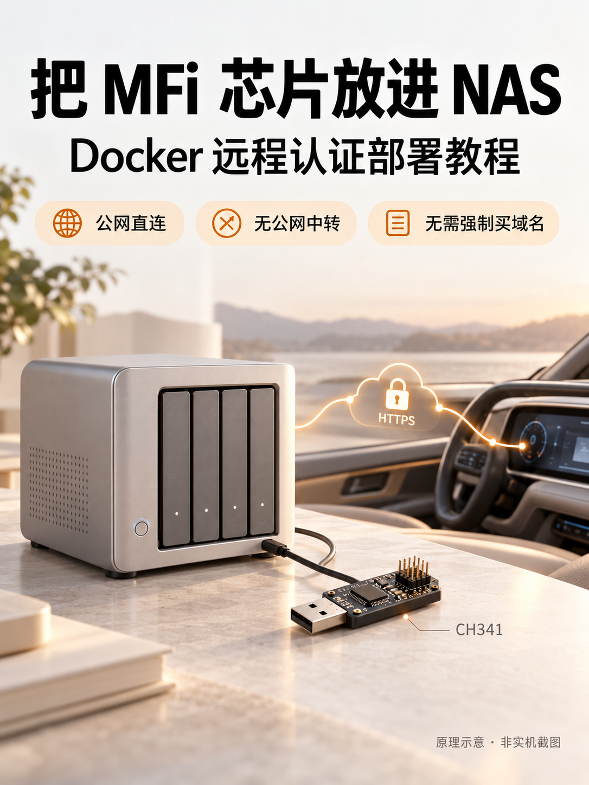
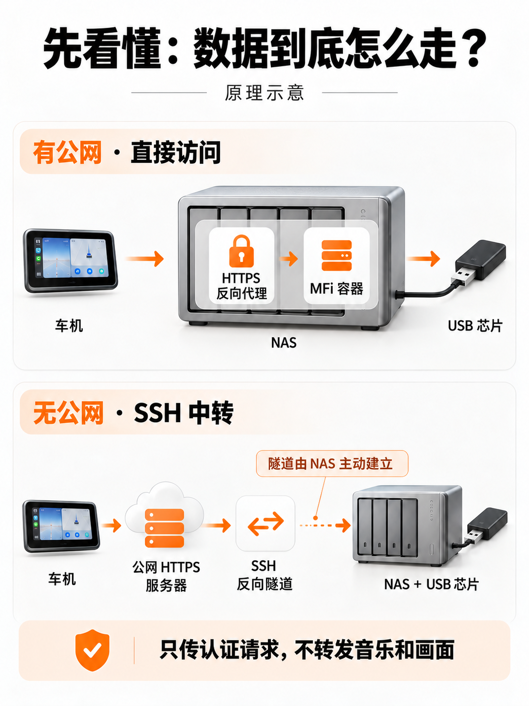

# Remote MFi Docker

把 CH341＋MFi Authentication 2.0C 模块放在 Linux NAS 或小主机上，通过网络为支持该接口的客户端提供证书读取与挑战签名。

**只处理认证，不传输 CarPlay 音乐和画面；不是软件模拟芯片，也不会导出芯片私钥。**



## 从这里开始

- 新手：[小白图文教程](小白图文教程.md)
- 实测范围：[验证记录](docs/VALIDATION.md)
- 接口：[API 说明](docs/API.md)
- 安全注意：[SECURITY.md](SECURITY.md)
- 版本变化：[CHANGELOG.md](CHANGELOG.md)

## 两种部署方式

| 网络条件 | 模式 | 路径 |
| --- | --- | --- |
| USB 宿主机有客户端可达的公网地址 | direct | 客户端 → HTTPS 反向代理 → MFi 容器 |
| 无公网或运营商 NAT | relay | 客户端 → 公网 HTTPS 服务器 → SSH 反向隧道 → MFi 容器 |



**不强制购买域名。**公网 IP 也可以，但需要匹配该 IP 且受客户端信任的 HTTPS 证书、自动续期和实际可达的网络。只有公网 IPv6 时，客户端也要能访问 IPv6。详见图文教程。

## 前提条件

- Linux、rootful Docker 和 Compose v2，USB 实际接在 Docker 宿主机上。
- USB VID:PID `1a86:5512` 的 CH341 I²C 模块与正确接线/供电的 MFi 2.0C 芯片。
- 客户端实现本服务的远程认证接口；不保证所有 CarPlay 软件兼容。
- 自己的 HTTPS 反向代理；relay 还需要自己可管理的公网 SSH 服务器。

目前已在一台 **ARMv7 海纳思（Docker 26.0.0）**上完成构建、7 项回归测试、真实芯片签名验签和本机服务验证。AMD64/ARM64、其他 NAS、远程公网和 iPhone 端到端仍需分别验证，不宣称全平台即插即用。

## 快速开始

```sh
git clone https://github.com/zy0816/remote-mfi-docker.git
cd remote-mfi-docker
cp .env.example .env
chmod 600 .env
openssl rand -hex 32
```

将最后一条生成的随机令牌写入 `.env` 的 `MFI_AUTH_TOKEN=` 后。示例故意留空，未设置时 Compose 会拒绝启动。已有 `.env` 时不要覆盖。不要公开令牌或带环境变量的容器检查输出。

确认没有其他实例占用 USB，选择下面一条路线。

### direct：公网直连／宿主反向代理

```sh
docker compose -f compose.yaml -f compose.direct.yaml config --quiet
docker compose -f compose.yaml -f compose.direct.yaml build
docker compose -f compose.yaml -f compose.direct.yaml run --rm --entrypoint python mfi -m mfi_service --check
docker compose -f compose.yaml -f compose.direct.yaml up -d
```

自检失败不要继续启动。direct **只发布宿主 `127.0.0.1:8787`**，不是直接公开 HTTP。按 [Nginx 模板](examples/nginx.conf) 配置宿主 HTTPS 代理；如果代理自身也是容器，需自行配置受控 Docker 网络，不能照抄该回环地址。

### relay：无公网 SSH 中转

先在公网服务器准备受限 SSH 账号，把专用私钥与核验过的 SSH 主机公钥文件放到：

```text
secrets/relay_ssh_key
secrets/relay_known_hosts
```

目录权限 `0700`，文件 `0600`，不要使用管理员私钥。填写 `.env` 中的 `RELAY_SSH_*` 配置，然后：

```sh
docker compose -f compose.yaml -f compose.relay.yaml config --quiet
docker compose -f compose.yaml -f compose.relay.yaml build
docker compose -f compose.yaml -f compose.relay.yaml run --rm --entrypoint python mfi -m mfi_service --check
docker compose -f compose.yaml -f compose.relay.yaml up -d
```

中转机的 Nginx 上游改为它自己的 `127.0.0.1:18787`；不将 18787 对公网开放。完整账号、公钥和证书步骤见图文教程。

### 客户端怎么填

- 认证方式：远程服务。
- 地址：`https://自己的公网IP或域名`，非标准 HTTPS 端口需带端口。
- 令牌：`.env` 中的值，不加 `Bearer ` 前缀。

地址末尾不加 `/mfi` 或 `/healthz`。客户端应与本服务 API 兼容。认证服务正常不等于蓝牙、热点、AirPlay 全部成功。

## 状态和维护

以下是 direct 示例；relay 时替换第二个 `-f` 文件，保持所有命令使用同一组文件。

```sh
docker compose -f compose.yaml -f compose.direct.yaml ps
docker compose -f compose.yaml -f compose.direct.yaml logs --tail=100 mfi
docker compose -f compose.yaml -f compose.direct.yaml exec mfi python -c "import urllib.request; print(urllib.request.urlopen('http://127.0.0.1:8787/healthz', timeout=3).read().decode())"
```

`ready:true` 是已保存的成功自检状态，不是每次都重新探测 USB。`healthy` 不检测 SSH 隧道/公网是否可用。USB 重新插入后可能需要空闲时重新初始化；Docker 不会仅因为 unhealthy 就自动重启。

首次 ARMv7 构建要下载 C 编译依赖并编译 cffi，弱 CPU 或慢网络可能耗时较久。Dockerfile 使用两阶段构建，最终镜像不带 gcc；apt 使用官方 HTTPS、IPv4 和有限重试，不修改宿主机 DNS/路由。仅有 IPv6 出站的构建环境需自行调整 Dockerfile 中的 `Acquire::ForceIPv4`。

## 测试

```sh
python3 -m venv .venv
. .venv/bin/activate
python -m pip install -r requirements.txt
python -m unittest discover -s tests -v
```

单测使用模拟硬件，不能代替 `--check` 的真实签名验签。`--check` 会操作芯片并执行签名，不要与生产认证并发。

## 已知边界

- 未提供 GHCR/Docker Hub 预构建镜像，需要自行构建；不是即刻点击运行的现成镜像。
- 容器 USB 授权范围包括已映射的其他 USB 设备，不是仅允许单颗芯片；不使用 privileged，但仍有隔离风险。
- SSH 隧道为后台进程，本地 healthy 不保证隧道健康；断网恢复有等待时间。
- 一颗芯片的硬件操作串行，不保证无限并发、永久可用或固定连接速度。
- macOS/Windows Docker 虚拟机、rootless Docker、其他芯片型号未验证。
- 不改变车辆系统，不提供 MFi 证书/私钥/模块或客户端授权，不绕过认证。

## 许可与来源

本仓库以 **GNU GPLv3** 分发，见 [LICENSE](LICENSE)。代码整理自维护者 ZCarPlay 关联项目中的独立 `nas-mfi-service` 模块；构建与文档在独立 ARMv7 部署中验证。与 [xcertplay](https://github.com/shilapi/xcertplay) 系列客户端有关联，但不是其官方服务发布，也不代表 Apple 或硬件厂商背书。依赖许可见 [第三方说明](THIRD_PARTY_NOTICES.md)。

欢迎支持开发、适配与技术服务；这不限制许可证赋予的使用、修改和再分发权利。配图为 AI 生成示意，不是接线图、实机截图或测试成功证据。
